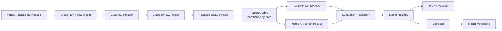

# Market Signal Pipeline

End-to-end machine learning pipeline for market signals on Google Cloud:
ingestion, feature engineering in BigQuery, training with BigQuery ML and
Vertex AI, batch/online serving, and drift monitoring.

The goal is not to promise returns. The goal is to build a **defensible,
leakage-free ML system** and document the decisions — including the ones that
show the signal is weak.

> Educational project. Not investment advice.

## Why this repo exists

This is the hands-on lab for the Google Cloud Professional Machine Learning
Engineer certification. Every week adds a piece of the production stack:

| Week | Capability | PMLE domain |
|---|---|---|
| 1 | Ingestion + BigQuery ML baseline | Low-code AI (~13%) |
| 2 | Feature engineering, Feature Store, evaluation | Data & experiments (~16%) |
| 3 | Custom training (Vertex AI containers, tuning) | Scaling prototypes (~21%) |
| 4 | Batch + online serving, Model Registry | Serving (~20%) |
| 5 | Vertex Pipelines + Cloud Build CI/CD/CT | Pipelines (~18%) |
| 6 | Model Monitoring, explainability, model card | Monitoring (~13%) |

## Architecture



## Repository layout

```
.
├── src/market_signals/
│   ├── config.py              # environment-driven settings
│   ├── ingest/fetch_prices.py # Stooq -> Parquet
│   ├── features/build_features.py
│   └── load/bigquery.py       # Parquet -> BigQuery
├── sql/
│   ├── 00_setup.sql
│   ├── 01_features.sql        # features in pure SQL
│   ├── 02_train_bqml.sql
│   ├── 03_evaluate.sql
│   └── 04_predict.sql
├── docs/
│   ├── architecture.md
│   └── decisions/0001-problem-framing.md
├── tests/test_features.py
└── .github/workflows/ci.yml
```

## Quickstart

```bash
python -m venv .venv
source .venv/bin/activate        # Windows: .venv\Scripts\activate
pip install -r requirements.txt

# 1. Download daily prices (no API key required)
python -m market_signals.ingest.fetch_prices --tickers SPY QQQ IWM --start 2010-01-01

# 2. Build features
python -m market_signals.features.build_features

# 3. Load to BigQuery (requires gcloud auth application-default login)
python -m market_signals.load.bigquery

# 4. Train and evaluate in BigQuery
bq query --use_legacy_sql=false < sql/02_train_bqml.sql
bq query --use_legacy_sql=false < sql/03_evaluate.sql
```

Set the project before running SQL:

```bash
export GCP_PROJECT=your-project-id
export BQ_DATASET=market_signals
```

### BigQuery sandbox

This project runs on the **BigQuery sandbox** (no billing account required):
1 TiB of queries per month, tables expire after 60 days, and DML/streaming are
not available. `bq load` and `CREATE MODEL` work, which is all this pipeline
needs. Training a model on the current table processes ~30 GB, so keep an eye
on the monthly quota.

```bash
bq mk --dataset --location=US "$GCP_PROJECT:market_signals"
bq load --source_format=PARQUET "$GCP_PROJECT:market_signals.features" data/processed/features.parquet
bq query --use_legacy_sql=false < sql/02_train_bqml.sql   # replace YOUR_PROJECT_ID first
```

## Problem framing

- **Universe:** liquid US ETFs (SPY, QQQ, IWM, DIA).
- **Horizon:** 5 trading days.
- **Target:** probability that the forward 5-day return is positive.
- **Split:** strictly temporal (train ≤ 2022, validation 2023, test ≥ 2024).
- **Costs:** the backtest charges commission and slippage. A model that only
  wins before costs is reported as no edge.

See `docs/decisions/0001-problem-framing.md`.

## Data

Daily OHLCV from the public **Yahoo Finance chart API** (no key required).
No data is committed to this repository; `data/` is ignored. Yahoo's terms
apply: this is an educational project, not a data redistribution service.

## First baseline (no edge yet)

Local baseline before BigQuery ML, temporal split at 2022-12-31:

| Model | AUC | Log loss | Accuracy | Precision top 10% |
|---|---|---|---|---|
| Naive (always up) | 0.500 | — | 0.575 | 0.575 |
| Logistic regression | 0.497 | 0.694 | 0.485 | 0.589 |
| Hist. gradient boosting | 0.494 | 0.701 | 0.549 | 0.587 |
| BigQuery ML (boosted trees) | 0.498 | 0.714 | 0.494 | — |

Train: 12,892 rows. Test: 3,872 rows (2023-01-03 → 2026-11-10). Positive rate: 57.5%.

These numbers are the point of the project: the pipeline runs end to end and
the evaluation is honest. With these features and a 5-day horizon, both models
are indistinguishable from a coin flip and the naive rule wins on accuracy.
The next iterations test regime features, other horizons and a cross-sectional
ranking target. If nothing beats the baseline, this repo will say so.

## Status

- [x] Repository scaffold
- [x] Ingestion script
- [x] Feature engineering (Python + SQL)
- [x] Local baseline with honest evaluation
- [x] BigQuery ML baseline (sandbox, no billing account)
- [ ] Evaluation report and cost-aware backtest
- [ ] Vertex AI custom training
- [ ] Vertex Pipelines + Cloud Build
- [ ] Model Registry, batch/online serving
- [ ] Model Monitoring and model card

## License

MIT
