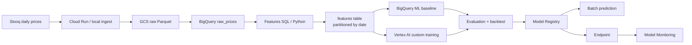

# Market Signal Pipeline

End-to-end machine learning pipeline for market signals on Google Cloud:
ingestion, feature engineering in BigQuery, training with BigQuery ML and
Vertex AI, batch/online serving, and drift monitoring.

The goal is not to promise returns. The goal is to build a **defensible,
leakage-free ML system** and document the decisions — including the ones that
show the signal is weak.

> Educational project. Not investment advice.

## Why this repo exists

This is the hands-on lab for the Google Cloud Professional Machine Learning
Engineer certification. Every week adds a piece of the production stack:

| Week | Capability | PMLE domain |
|---|---|---|
| 1 | Ingestion + BigQuery ML baseline | Low-code AI (~13%) |
| 2 | Feature engineering, Feature Store, evaluation | Data & experiments (~16%) |
| 3 | Custom training (Vertex AI containers, tuning) | Scaling prototypes (~21%) |
| 4 | Batch + online serving, Model Registry | Serving (~20%) |
| 5 | Vertex Pipelines + Cloud Build CI/CD/CT | Pipelines (~18%) |
| 6 | Model Monitoring, explainability, model card | Monitoring (~13%) |

## Architecture



## Repository layout

```
.
├── src/market_signals/
│   ├── config.py              # environment-driven settings
│   ├── ingest/fetch_prices.py # Stooq -> Parquet
│   ├── features/build_features.py
│   └── load/bigquery.py       # Parquet -> BigQuery
├── sql/
│   ├── 00_setup.sql
│   ├── 01_features.sql        # features in pure SQL
│   ├── 02_train_bqml.sql
│   ├── 03_evaluate.sql
│   └── 04_predict.sql
├── docs/
│   ├── architecture.md
│   └── decisions/0001-problem-framing.md
├── tests/test_features.py
└── .github/workflows/ci.yml
```

## Quickstart

```bash
python -m venv .venv
source .venv/bin/activate        # Windows: .venv\Scripts\activate
pip install -r requirements.txt

# 1. Download daily prices (no API key required)
python -m market_signals.ingest.fetch_prices --tickers SPY QQQ IWM --start 2010-01-01

# 2. Build features
python -m market_signals.features.build_features

# 3. Load to BigQuery (requires gcloud auth application-default login)
python -m market_signals.load.bigquery

# 4. Train and evaluate in BigQuery
bq query --use_legacy_sql=false < sql/02_train_bqml.sql
bq query --use_legacy_sql=false < sql/03_evaluate.sql
```

Set the project before running SQL:

```bash
export GCP_PROJECT=your-project-id
export BQ_DATASET=market_signals
```

## Problem framing

- **Universe:** liquid US ETFs (SPY, QQQ, IWM, DIA).
- **Horizon:** 5 trading days.
- **Target:** probability that the forward 5-day return is positive.
- **Split:** strictly temporal (train ≤ 2022, validation 2023, test ≥ 2024).
- **Costs:** the backtest charges commission and slippage. A model that only
  wins before costs is reported as no edge.

See `docs/decisions/0001-problem-framing.md`.

## Data

Daily OHLCV from [Stooq](https://stooq.com/) public CSV endpoints. No data is
committed to this repository; `data/` is ignored. Check Stooq's terms before
any redistribution or commercial use.

## Status

- [x] Repository scaffold
- [x] Ingestion script
- [x] Feature engineering (Python + SQL)
- [x] BigQuery ML baseline
- [ ] Evaluation report and cost-aware backtest
- [ ] Vertex AI custom training
- [ ] Vertex Pipelines + Cloud Build
- [ ] Model Registry, batch/online serving
- [ ] Model Monitoring and model card

## License

MIT
